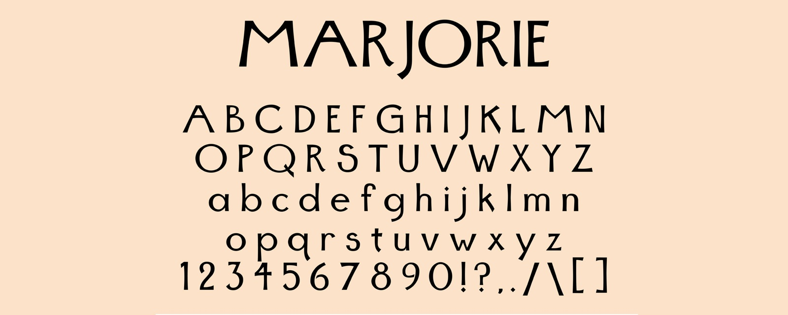

# Marjorie



**Marjorie** is a geometric display typeface with Art Deco bones — high-waisted proportions, classical Roman skeletons, and clean monoline strokes. Drawn for headlines, posters, logotypes, and packaging, where a single confident voice carries the layout.

Free and open source under the [SIL Open Font License 1.1](OFL.txt).

## Specimen

One weight — **Regular** — with 460 glyphs covering:

- Uppercase and lowercase Latin (`A–Z`, `a–z`)
- Figures `0–9` and basic punctuation
- Accented Latin characters for Western European languages

Built for display sizes. It sings as a headline and on a poster; for long passages of body text, reach for something else.

## Install

**Desktop** — download a font from [`fonts/`](fonts/) (or a tagged [release](../../releases)) and double-click to install:

- `Marjorie-Regular.otf` — OpenType, recommended for desktop
- `Marjorie-Regular.ttf` — TrueType, for broad compatibility

**Web** — use the WOFF2 with an `@font-face` rule:

```css
@font-face {
  font-family: "Marjorie";
  src: url("Marjorie-Regular.woff2") format("woff2"),
       url("Marjorie-Regular.woff") format("woff");
  font-weight: 400;
  font-style: normal;
  font-display: swap;
}
```

## Building from source

The source of truth is [`sources/Marjorie.glyphs`](sources/Marjorie.glyphs), drawn in [Glyphs](https://glyphsapp.com/).

- **In Glyphs:** open the source and `File → Export` to OTF / TTF / Web (WOFF2).
- **Command line** ([fontmake](https://github.com/googlefonts/fontmake)):

  ```sh
  pip install fontmake
  fontmake -g sources/Marjorie.glyphs -o otf ttf
  ```

## License

Marjorie is licensed under the **SIL Open Font License, Version 1.1** — see [`OFL.txt`](OFL.txt). You can use it, study it, modify it, and bundle it (including in commercial work) freely. You can't sell the font by itself, and any derivative must be released under the OFL with a different primary font name — **"Marjorie" is a Reserved Font Name**.

See [`FONTLOG.txt`](FONTLOG.txt) for version history.

## Author

Designed by **David Tucker** — type design and creative technology.
[tvcker.com](https://tvcker.com) · [@inkxel](https://instagram.com/inkxel)
